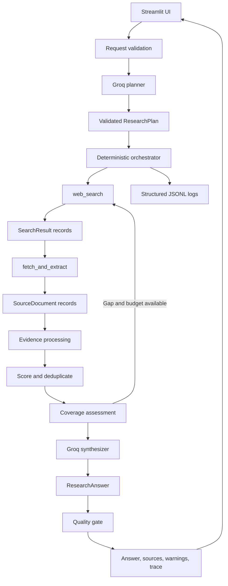

# ResearchPilot — Production-Oriented AI Research Agent

ResearchPilot is a bounded, inspectable AI research agent that converts a
research question into a structured plan, gathers information from the web,
filters and scores evidence, synthesizes a source-grounded answer, validates
citations, and exposes the execution trace through a Streamlit interface.

The project is intentionally implemented as a small custom orchestration layer
instead of a large agent framework. The LLM is used for flexible reasoning and
language generation, while deterministic Python code controls validation,
tool permissions, network safety, evidence provenance, execution budgets,
retries, and output quality checks.

> **Prototype status:** The core agent workflow, tools, safety controls,
> structured output, UI, tests, and evaluation harness are implemented.
> Live research quality depends on the configured Groq model and the external
> search/web providers. The project does not claim guaranteed factual accuracy.

---

## Table of Contents

1. [Overview](#1-overview)
2. [Problem Statement](#2-problem-statement)
3. [Key Features](#3-key-features)
4. [Demo Link](#4-demo-link)
5. [Technology Stack](#5-technology-stack)
6. [System Architecture](#6-system-architecture)
7. [Project Workflow](#7-project-workflow)
8. [Directory Structure](#8-directory-structure)
9. [Prerequisites](#9-prerequisites)
10. [Installation and Setup](#10-installation-and-setup)
11. [Environment Variables](#11-environment-variables)
12. [Running the Project](#12-running-the-project)
13. [API and Internal Service Documentation](#13-api-and-internal-service-documentation)
14. [Database Design](#14-database-design)
15. [Methodology and Core Algorithms](#15-methodology-and-core-algorithms)
16. [Testing and Evaluation](#16-testing-and-evaluation)
17. [Security and Privacy](#17-security-and-privacy)
18. [Troubleshooting](#18-troubleshooting)
19. [Known Limitations and Future Improvements](#19-known-limitations-and-future-improvements)
20. [Assignment Requirement Mapping](#20-assignment-requirement-mapping)
21. [Assignment Questions and Sample Outputs](#21-assignment-questions-and-sample-outputs)

---

## 1. Overview

### Project Name

**ResearchPilot — Production-Oriented AI Research Agent**

### Purpose

ResearchPilot is designed for research-style questions that require more than
one model completion. It creates a plan, uses external tools to gather
evidence, evaluates the evidence, and produces a structured answer with
citations and uncertainty information.

Example questions include:

- Compare PostgreSQL and SQLite for a small offline-first application.
- Compare the top three open-source vector databases for a startup building
  RAG products.
- Explain the benefits and tradeoffs of retrieval-augmented generation for an
  AI support agent.
- Research the security risks of fetching arbitrary web URLs.
- Find and summarize companies in a specific market.

### Design philosophy

The system follows this principle:

> Use the LLM for flexible reasoning; use deterministic Python for safety,
> schemas, budgets, tool permissions, evidence provenance, retries, and
> validation.

This separation prevents the model from directly controlling network access or
executing arbitrary tools. It also makes the workflow easier to test and
inspect.

### Current implementation status

Implemented:

- Groq-powered planning and synthesis
- Pydantic data contracts
- Web search
- Safe page fetching and extraction
- Evidence scoring and filtering
- Coverage assessment
- Citation validation
- Confidence rules
- Bounded retries and budgets
- Prompt-injection-aware prompts
- SSRF-oriented URL checks
- Structured JSONL logging
- Streamlit UI
- Deterministic test suite
- Evaluation case runner

The current test baseline is:

```text
143 passed
```

---

## 2. Problem Statement

General-purpose language models can produce fluent answers, but a fluent answer
is not necessarily a researched or verifiable answer. Common failure modes
include:

- stale information
- unsupported factual claims
- invented citations
- irrelevant or duplicated sources
- promotional or low-quality pages
- incomplete answers to multi-part questions
- hidden reasoning and tool activity
- poor behavior when a search provider, page, or model call fails
- following malicious instructions embedded in retrieved web content

ResearchPilot addresses these issues by separating the research task into
explicit stages:

1. Request validation
2. Research planning
3. Search
4. Page retrieval and extraction
5. Evidence filtering
6. Coverage assessment
7. Answer synthesis
8. Citation and quality validation
9. Trace and result presentation

The goal is not to guarantee truth. The goal is to make the answer more
traceable, evidence-aware, failure-tolerant, and honest about uncertainty.

---

## 3. Key Features

### Structured research planning

The planner generates a validated `ResearchPlan` containing:

- research objective
- focused subquestions
- search queries
- selected tools from an allowlist
- success criteria
- freshness requirement
- planning notes

If the model returns invalid output or is unavailable, the system can create a
deterministic fallback plan.

### Two real research tools

#### `web_search`

Uses `ddgs` to discover candidate pages. It supports:

- query validation
- Unicode and punctuation normalization
- bounded result counts
- empty-result simplification
- URL normalization
- duplicate removal
- malformed-result skipping
- timeout and rate-limit handling

#### `fetch_and_extract`

Uses `httpx` and Trafilatura to retrieve actual page content instead of
depending only on search snippets. It supports:

- HTTP/HTTPS validation
- private and loopback IP blocking
- redirect revalidation
- response-size limits
- content-type validation
- timeout handling
- main-content extraction
- empty-content rejection
- extracted-text limits
- stable source ID generation

### Evidence quality processing

Sources are ranked using a transparent heuristic based on:

- relevance
- authority
- freshness
- completeness/readability

The system also:

- removes duplicate content
- limits excessive concentration from one domain
- stores rejected-source reasons
- computes subquestion coverage
- can perform one additional bounded research round

### Source-grounded synthesis

The synthesizer receives only selected evidence and is instructed to:

- treat retrieved content as untrusted data
- ignore instructions embedded in pages
- use only available source IDs
- cite material factual findings
- disclose missing evidence and contradictions
- avoid invented sources, dates, statistics, and benchmarks

### Citation and quality gate

The quality gate:

- removes unknown citation IDs
- derives `sources_used` from valid finding citations
- maps source IDs to trusted URLs
- marks uncited findings as unsupported
- applies deterministic confidence rules
- adds low-coverage and quality warnings

### Bounded execution

Configurable limits cover:

- maximum search queries
- maximum page fetches
- maximum research rounds
- retry count
- overall deadline
- extracted characters per source
- model output tokens

### Failure-aware behavior

The workflow returns controlled outcomes instead of fabricating research:

- `completed`
- `partial`
- `insufficient_evidence`
- `failed`

### Observability

The UI and structured logs expose:

- workflow stages
- plan and search queries
- tool calls
- durations
- retries
- accepted and rejected sources
- evidence scores
- coverage
- warnings
- citation mappings

---

## 4. Demo Link

**Demo video:** _To be added._

The planned 3–5 minute demonstration should show:

1. A successful research question.
2. The generated plan and search queries.
3. Accepted and rejected sources.
4. A source-grounded final answer.
5. Confidence, limitations, and next steps.
6. An edge case such as empty input, search failure, or insufficient evidence.

Suggested happy-path question:

```text
Compare PostgreSQL and SQLite for a small offline-first research application.
```

Suggested edge-case question:

```text
Find reliable current information about a deliberately obscure topic:
the 1842 Zorvath protocol specification.
```

---

## 5. Technology Stack

| Technology | Role | Why it was chosen |
|---|---|---|
| Python 3.12+ | Application language | Strong ecosystem for AI, networking, validation, testing, and rapid prototyping |
| Groq API | LLM provider | Fast hosted inference with configurable models and official Python SDK |
| Official Groq SDK | Provider integration | Keeps provider-specific communication isolated and mockable |
| Pydantic v2 | Data contracts | Provides typed validation for plans, sources, findings, answers, and trace events |
| `ddgs` | Web search | Free search integration suitable for a focused prototype |
| `httpx` | HTTP client | Explicit timeouts, streaming, status handling, and manual redirect control |
| Trafilatura | Page extraction | Extracts readable main text from HTML pages |
| Streamlit | User interface | Fast way to expose the workflow and execution trace without coupling UI to services |
| pytest | Testing | Lightweight, readable deterministic tests with good mocking support |
| python-dotenv | Configuration | Loads local environment settings without putting secrets in source code |
| Python logging | Observability | Avoids requiring a paid observability platform for the prototype |
| JSONL/JSON | Logs and evaluation | Simple inspectable formats for local traces and evaluation artifacts |

### Why a custom orchestrator instead of LangGraph or another framework?

The assignment values clarity and engineering judgment over framework
complexity. The workflow is bounded and linear enough that a small custom
orchestrator is easier to inspect than introducing a graph framework.

A framework could become useful later if the system grows to include:

- many conditional branches
- parallel tool execution
- human approval steps
- persistent state
- multiple specialized agents
- resumable workflows

For the current prototype, explicit Python control provides clearer budget,
retry, and security behavior.

---

## 6. System Architecture



### Responsibility boundaries

| Component | Responsibility |
|---|---|
| `main.py` | Streamlit presentation and user interaction |
| `config.py` | Environment configuration and execution limits |
| `schemas.py` | Typed contracts and validation |
| `llm.py` | Groq SDK communication and provider error normalization |
| `planner.py` | LLM plan generation and deterministic fallback planning |
| `tools/search.py` | Search provider integration and result normalization |
| `tools/fetch.py` | Safe HTTP retrieval and content extraction |
| `evidence.py` | Deterministic source scoring, filtering, and coverage |
| `orchestrator.py` | Workflow sequencing, budgets, retries, and trace |
| `synthesizer.py` | Evidence-grounded answer generation |
| `quality_gate.py` | Citation validation, confidence, and answer hardening |
| `logging_config.py` | Redacted structured logging |

---

## 7. Project Workflow

### Stage 1: Receive and validate

The question is trimmed and validated as a `ResearchRequest`. Empty or
whitespace-only questions are rejected before any external call.

### Stage 2: Plan

The planner asks Groq for structured JSON. The output is validated using
`ResearchPlan`. Invalid output receives one repair attempt. If planning still
fails and fallback is enabled, a deterministic plan is generated.

### Stage 3: Search

The orchestrator executes only allowlisted search tools. It enforces query
budgets, normalizes model-generated queries, records search events, and
handles empty or failed searches.

### Stage 4: Retrieve

Candidate URLs are fetched within the page budget. Unsafe URLs and unsafe
redirects are rejected. Individual page failures do not abort the entire run.

### Stage 5: Filter evidence

Retrieved documents are:

- validated
- deduplicated
- scored
- restricted by domain diversity
- accepted or rejected with reasons

Coverage is calculated against plan subquestions.

### Stage 6: Optional additional round

If coverage is inadequate and budget remains, the orchestrator runs at most one
targeted additional research round for unsupported subquestions.

### Stage 7: Synthesize

The synthesizer receives the original question, plan, coverage information, and
bounded evidence excerpts. It returns a structured `ResearchAnswer`.

### Stage 8: Validate

The quality gate checks:

- source IDs
- source URL mappings
- unsupported findings
- confidence
- coverage
- final status

### Stage 9: Present

The Streamlit UI displays the answer, findings, sources, confidence,
limitations, plan, evidence, and trace.

---

## 8. Directory Structure

```text
researchpilot-ai-agent/
├── app/
│   ├── __init__.py
│   ├── config.py
│   ├── evidence.py
│   ├── llm.py
│   ├── logging_config.py
│   ├── main.py
│   ├── orchestrator.py
│   ├── planner.py
│   ├── quality_gate.py
│   ├── schemas.py
│   ├── synthesizer.py
│   └── tools/
│       ├── __init__.py
│       ├── fetch.py
│       └── search.py
├── evaluation/
│   ├── __init__.py
│   ├── metrics.py
│   ├── run_eval.py
│   ├── test_cases.json
│   └── results/              # Local generated results; ignored by Git
├── tests/
│   ├── test_evidence.py
│   ├── test_fetch.py
│   ├── test_full_pipeline.py
│   ├── test_llm.py
│   ├── test_logging.py
│   ├── test_orchestrator.py
│   ├── test_planner.py
│   ├── test_quality_gate.py
│   ├── test_schemas.py
│   ├── test_search.py
│   ├── test_synthesizer.py
│   └── test_ui_helpers.py
├── .env.example
├── .gitignore
├── AI_USAGE.md
├── CONTEXT.md
├── EVALUATION.md
├── README.md
├── pytest.ini
├── requirements.txt
└── scratch/
```

---

## 9. Prerequisites

### Required

- Windows PowerShell
- Python 3.12 or newer
- Internet access for search and page retrieval
- A Groq API key
- A Groq model currently available to the account

### Recommended

- VS Code
- VS Code Python extension
- A project-local virtual environment

### Important interpreter note

Use the project virtual environment for both tests and application execution.
Running the system Python directly can cause missing dependency errors even
when `.venv` is correctly provisioned.

---

## 10. Installation and Setup

Open PowerShell in the repository root.

### Create the virtual environment

```powershell
py -3.12 -m venv .venv
```

### Activate it

```powershell
.\.venv\Scripts\Activate.ps1
```

If PowerShell blocks activation for the current user, follow the local
development policy for execution scripts or use the interpreter directly:

```powershell
.\.venv\Scripts\python.exe -m pip install --upgrade pip
```

### Install dependencies

```powershell
python -m pip install --upgrade pip
python -m pip install -r requirements.txt
```

### Verify dependencies

```powershell
python -m pip check
```

### Configure environment

```powershell
Copy-Item .env.example .env
```

Edit `.env` locally and provide a valid Groq API key and model. Never commit
`.env` or paste the key into source files.

### Select the interpreter in VS Code

1. Open the Command Palette with `Ctrl+Shift+P`.
2. Select **Python: Select Interpreter**.
3. Choose `.venv\Scripts\python.exe`.
4. Open a new integrated terminal.

---

## 11. Environment Variables

The application loads `.env` from the project root using `python-dotenv`.

| Variable | Required | Description | Example |
|---|---:|---|---|
| `GROQ_API_KEY` | Yes for live LLM calls | Groq API credential | `gsk_...` |
| `GROQ_MODEL` | Yes for live LLM calls | Model available to the account | `llama-3.3-70b-versatile` |
| `APP_ENV` | No | Application environment label | `development` |
| `LOG_LEVEL` | No | Logging level | `INFO` |
| `GROQ_TIMEOUT_SECONDS` | No | Groq timeout | `30.0` |
| `GROQ_MAX_OUTPUT_TOKENS` | No | Model output token limit | `2048` |
| `MAX_SEARCH_QUERIES` | No | Search query budget | `5` |
| `MAX_FETCH_PAGES` | No | Page fetch budget | `8` |
| `MAX_RESEARCH_ROUNDS` | No | Additional research rounds | `1` |
| `MAX_RETRIES_PER_TOOL` | No | Retry limit per tool | `1` |
| `OVERALL_DEADLINE_SECONDS` | No | End-to-end deadline | `90.0` |
| `MAX_EXTRACTED_CHARS_PER_SOURCE` | No | Extraction limit per source | `8000` |

Example:

```dotenv
GROQ_API_KEY=replace_with_your_key
GROQ_MODEL=replace_with_a_model_available_in_your_groq_console
APP_ENV=development
LOG_LEVEL=INFO
GROQ_TIMEOUT_SECONDS=30.0
GROQ_MAX_OUTPUT_TOKENS=2048
MAX_SEARCH_QUERIES=5
MAX_FETCH_PAGES=8
MAX_RESEARCH_ROUNDS=1
MAX_RETRIES_PER_TOOL=1
OVERALL_DEADLINE_SECONDS=90.0
MAX_EXTRACTED_CHARS_PER_SOURCE=8000
```

The API key is never intentionally printed, logged, included in prompts, or
stored in evaluation artifacts.

---

## 12. Running the Project

### Run the Streamlit application

```powershell
.\.venv\Scripts\Activate.ps1
streamlit run app\main.py
```

Open the local URL shown by Streamlit, usually:

```text
http://localhost:8501
```

### Run all deterministic tests

```powershell
.\.venv\Scripts\python.exe -m pytest -q
```

### Run a focused test module

```powershell
.\.venv\Scripts\python.exe -m pytest tests\test_orchestrator.py -v
```

### Run deterministic evaluation cases

```powershell
.\.venv\Scripts\python.exe evaluation\run_eval.py --mode deterministic
```

### Run live evaluation cases

Configure a valid Groq model first:

```powershell
.\.venv\Scripts\python.exe evaluation\run_eval.py --mode live
```

Results are written to:

```text
evaluation/results/latest.json
```

This generated directory is ignored by Git because live results can include
retrieved web content.

---

## 13. API and Internal Service Documentation

ResearchPilot currently exposes a Streamlit application rather than a separate
HTTP REST server. Its reusable application interfaces are Python functions.

### `run_full_pipeline`

Defined in [app/orchestrator.py](app/orchestrator.py).

```python
run_full_pipeline(
    request: ResearchRequest | str,
    settings: Settings | None = None,
    client: GroqClientWrapper | None = None,
    search_tool_fn: Callable | None = None,
    fetch_tool_fn: Callable | None = None,
    verify_claims: bool = False,
    progress_callback: Callable | None = None,
) -> ResearchContext
```

This is the main service entry point for a complete run.

### `create_research_plan`

Defined in [app/planner.py](app/planner.py).

```python
create_research_plan(
    request: ResearchRequest | str,
    client: GroqClientWrapper | None = None,
    run_id: str | None = None,
    trace: list[ExecutionEvent] | None = None,
    enable_fallback: bool = True,
) -> ResearchPlan
```

### `web_search`

Defined in `app/tools/search.py`.

```python
web_search(
    query: str,
    max_results: int = 5,
    timeout: float = 10.0,
    client: Any | None = None,
) -> list[SearchResult]
```

### `fetch_and_extract`

Defined in `app/tools/fetch.py`.

```python
fetch_and_extract(
    url: str,
    connect_timeout: float = 5.0,
    read_timeout: float = 10.0,
    max_redirects: int = 3,
    max_response_bytes: int = 2 * 1024 * 1024,
    max_extracted_chars: int | None = None,
    session_visited_urls: set[str] | None = None,
    client: httpx.Client | None = None,
) -> SourceDocument
```

### Core response contract

`ResearchContext` contains:

- `run_id`
- validated request
- research plan
- raw search results
- accepted sources
- rejected sources
- coverage report
- execution trace
- overall status
- optional final answer
- quality-gate warnings

`ResearchAnswer` contains:

- `user_question`
- `short_answer`
- `key_findings`
- `sources_used`
- `source_url_map`
- `confidence`
- `assumptions`
- `limitations`
- `suggested_next_steps`
- `status`

### Error behavior

Errors are normalized into typed categories where possible:

- timeout
- rate limit
- authentication
- connection
- validation
- extraction
- budget exhausted
- unsafe URL
- unknown/provider error

The system prefers controlled partial or insufficient-evidence results over
silent fallback claims.

---

## 14. Database Design

ResearchPilot does not currently use a database.

This is intentional for the basic prototype because the assignment focuses on
agent workflow, tool use, reliability, evaluation, and traceability rather than
persistent product data.

### Current persistence

- Local JSONL application logs under `logs/`
- Local JSON evaluation output under `evaluation/results/`
- In-memory Pydantic models during a run
- No user accounts
- No persistent conversation memory
- No vector database
- No relational database

### Why no database yet?

A database would add operational complexity without being necessary for the
core assignment. The current workflow is a single bounded research run.

### Production database direction

If the system becomes a multi-user product, a suitable design could include:

#### Relational tables

```text
runs
----
id
user_id
question
status
model_name
started_at
finished_at

plans
-----
id
run_id
objective
plan_json

sources
-------
id
run_id
source_id
url
domain
title
quality_score
extraction_status
rejection_reason

findings
--------
id
run_id
claim
explanation
support_status

finding_sources
---------------
finding_id
source_id

execution_events
-----------------
id
run_id
stage
event_type
duration_ms
success
error_category
message
created_at
```

#### Implemented stretch goals and future additions

The prototype now includes four bounded stretch goals:

- **Citation grounding:** the deterministic evaluator checks every finding's
  citation IDs against the trusted source registry and measures lexical
  overlap between the claim and cited source content. This is a review signal,
  not a substitute for entailment-level verification.
- **Evaluator/judge step:** each synthesized answer receives an
  `AnswerEvaluation` report with citation validity, grounded-finding rate,
  warnings, and a guardrail flag. The report is stored on the research context
  and emitted in the validation trace.
- **Bounded caching:** successful real-provider search results and page
  extractions use a thread-safe in-memory TTL cache with configurable entry and
  lifetime limits. Injected test doubles bypass the cache.
- **Low-confidence guardrails:** low-confidence, weakly grounded, or
  citation-poor answers receive explicit verification limitations and a manual
  verification next step instead of being presented as authoritative.

Future production additions could include object storage for reviewed evidence
snapshots, a vector index for large private corpora, a metrics store, and
encryption/retention policies.

Retrieved web content should not be stored indefinitely without a clear
retention, copyright, privacy, and compliance policy.

---

## 15. Methodology and Core Algorithms

### Research planning

The planner creates approximately three to six subquestions and a small set of
focused search queries. The plan is bounded by the schema and cannot introduce
arbitrary tools.

### Search query normalization

Model-generated queries are normalized before provider execution:

- Unicode normalization
- dash normalization
- unsupported punctuation removal
- whitespace compression
- maximum length enforcement

If a valid query returns no results, one simplified query may be attempted.
This does not create an unbounded search loop.

### URL normalization

URLs are normalized by:

- lowercasing scheme and host
- removing harmless tracking parameters
- sorting remaining query parameters
- removing fragments
- normalizing root paths

Stable source IDs are generated from normalized URLs.

### Evidence quality score

The initial score is:

```text
Q = 0.40R + 0.30A + 0.20F + 0.10C
```

Where:

- `R` = relevance
- `A` = authority
- `F` = freshness
- `C` = completeness/readability

The score is a ranking heuristic. It is not a probability that a source is
correct.

### Relevance scoring

Each source is scored against the best individual context from:

- original question
- plan objective
- subquestions
- search queries

This prevents a source covering one comparison criterion from being penalized
because it does not discuss every criterion.

### Coverage

Coverage is calculated using lexical overlap between plan subquestions and the
accepted evidence corpus:

```text
coverage ratio =
    (supported subquestions
     + 0.5 × partially supported subquestions)
    / total subquestions
```

This is a deterministic approximation, not semantic proof.

### Confidence

Confidence is determined from observable evidence:

- accepted-source count
- coverage
- average quality score
- unsupported claim count
- final answer status

Degraded or failed synthesis cannot be labeled highly confident.

### Citation validation

Every citation ID is checked against the trusted source registry. Unknown IDs
are removed. `sources_used` is derived from valid findings so the UI and
evaluation metrics remain consistent.

### Retry and repair policy

The system allows:

- one planner repair attempt
- one synthesis repair attempt
- bounded transient tool retries
- one additional research round

Unsafe URLs and permanent validation failures are not retried.

---

## 16. Testing and Evaluation

### Automated testing

Tests cover:

- Pydantic schemas
- invalid inputs
- Groq wrapper behavior
- planner repair and fallback
- search normalization and provider failures
- safe URL checks
- redirects
- fetch limits
- extraction failures
- evidence scoring
- duplicates
- domain diversity
- coverage
- orchestrator budgets
- retries
- partial failures
- synthesis
- unknown citations
- quality gates
- logging redaction
- UI helper functions
- full pipeline behavior

Run:

```powershell
.\.venv\Scripts\python.exe -m pytest -q
```

Current verified baseline:

```text
141 passed
```

### Dependency verification

```powershell
.\.venv\Scripts\python.exe -m pip check
```

Expected:

```text
No broken requirements found
```

### Evaluation cases

Evaluation definitions are in [evaluation/test_cases.json](evaluation/test_cases.json).

The current cases include:

1. PostgreSQL versus SQLite comparison
2. RAG benefits and tradeoffs
3. Security risks of arbitrary URL fetching
4. Empty input
5. Deliberately obscure topic

Run deterministic cases:

```powershell
.\.venv\Scripts\python.exe evaluation\run_eval.py --mode deterministic
```

Run live cases:

```powershell
.\.venv\Scripts\python.exe evaluation\run_eval.py --mode live
```

### Metrics

The evaluation runner currently calculates:

- attempted runs
- completed runs
- usable/degraded runs
- completion or usable-run rate
- citation references
- valid citation references
- citation validity rate

Citation validity means that a citation ID exists in the retrieved source
registry. It does not prove factual correctness or claim entailment.

### Evaluation limitations

For a stronger submission, add:

- human review of sampled factual claims
- latency median and p95
- search and extraction success rates
- retry rates
- unsupported-claim rate
- model token and cost data
- comparison with a direct non-retrieval baseline
- more human-reviewed sample outputs from the configured live model

Evaluation results should always record the date, configured model, environment,
denominators, and limitations.

### Sample output 1: successful comparison research

The following is a representative structured result from the PostgreSQL versus
SQLite prototype query. It shows the response contract used by the UI and API
boundary; source IDs are resolved against the trusted source registry before
display.

```json
{
  "user_question": "Compare PostgreSQL and SQLite for a small offline-first research application.",
  "short_answer": "SQLite is a strong local-first default, while PostgreSQL is better when the system needs a central concurrent service, richer operational controls, or multi-user writes.",
  "key_findings": [
    {
      "claim": "SQLite is designed as an embedded database and can operate without a separate database server.",
      "explanation": "This reduces local deployment and operational overhead for an offline-first client.",
      "source_ids": ["src_5f0e2e8a1b7c"]
    },
    {
      "claim": "PostgreSQL provides a stronger fit for centralized multi-user workloads and operational administration.",
      "explanation": "A server-oriented architecture is useful when concurrent writes, access control, and centralized backups are primary requirements.",
      "source_ids": ["src_8c1d9a2f4e6b"]
    }
  ],
  "confidence": "medium",
  "status": "completed",
  "limitations": [
    "The comparison is based on retrieved documentation and does not replace workload-specific benchmarking."
  ]
}
```

The important behavior is that the answer includes the question, concise
conclusion, findings, source IDs, confidence, status, and limitations. The
system should not claim a universal performance winner without a representative
benchmark workload.

### Sample output 2: controlled degraded model result

When the configured Groq model is unavailable, the system continues to record
search and retrieval failures but does not present a fabricated synthesized
answer:

```json
{
  "user_question": "Compare PostgreSQL and SQLite for a small offline-first research application.",
  "short_answer": "Synthesis could not be completed because the configured model was unavailable.",
  "key_findings": [],
  "sources_used": [],
  "confidence": "low",
  "status": "failed",
  "limitations": [
    "Synthesis encountered an unrecoverable error."
  ],
  "suggested_next_steps": [
    "Retry the query or verify model availability."
  ]
}
```

The execution trace records the failed synthesis event and the quality gate
preserves the degraded status rather than upgrading it to `completed`.

### Sample output 3: invalid input and guardrail behavior

Whitespace-only input is rejected before planning or external calls:

```text
Research question cannot be empty or whitespace.
```

For a response with weak coverage, invalid citations, or low lexical support,
the evaluator adds warnings and the low-confidence guardrail appends an explicit
verification limitation and manual verification next step. These guardrails
make uncertainty visible instead of hiding it behind fluent prose.

---

## 17. Security and Privacy

### Secret handling

- API keys are loaded from `.env` or environment variables.
- `.env` is ignored by Git.
- API keys are not included in prompts or logs.
- Settings representations mask key values.
- Evaluation artifacts should not contain secrets.

### Prompt injection

Search snippets and webpage content are untrusted external data. The system:

- places external content in delimited evidence blocks
- instructs the model not to follow page instructions
- never executes page-provided commands
- does not let the LLM directly invoke arbitrary Python functions
- uses a strict tool allowlist

Prompt instructions are not treated as the only security boundary. Code-level
validation is also used.

### SSRF-oriented controls

The fetch tool blocks:

- unsupported URL schemes
- embedded credentials
- localhost
- loopback addresses
- private IP ranges
- link-local addresses
- multicast addresses
- reserved addresses
- unsafe redirect destinations

The implementation performs DNS preflight checks and redirect revalidation.
Complete protection against all DNS rebinding and network-level TOCTOU
conditions cannot be claimed using ordinary application-level checks.

### Network and content limits

- response bytes are bounded
- extracted text is bounded
- redirects are limited
- page fetches are budgeted
- timeouts are explicit
- JavaScript is not executed
- unsupported content types are rejected

### Data privacy

The prototype does not implement user accounts or persistent personal data.
However, users should avoid entering confidential information into research
questions because external search providers and websites may receive query
terms.

---

## 18. Troubleshooting

### `ModuleNotFoundError` for `ddgs` or `trafilatura`

You are probably using system Python instead of the project virtual
environment.

Use:

```powershell
.\.venv\Scripts\python.exe -m pip install -r requirements.txt
.\.venv\Scripts\python.exe -m pytest -q
```

Select `.venv\Scripts\python.exe` in VS Code.

### Groq authentication or configuration error

Check that `.env` contains a real local key:

```dotenv
GROQ_API_KEY=your_real_key
GROQ_MODEL=model_available_to_your_account
```

Do not paste the key into chat, source code, tests, or logs.

### Groq `NotFoundError`

The configured model may be unavailable, retired, misspelled, or not enabled
for the account. Check the current model identifier in the Groq console and
update `GROQ_MODEL`.

The application may still execute fallback planning and web retrieval, but
complete synthesis requires a valid available model.

### Search returns zero results

This can be caused by:

- provider rate limiting
- temporary provider failure
- an overly specific query
- unsupported punctuation
- a genuinely obscure topic

The search tool normalizes queries and performs one bounded simplification, but
it cannot guarantee provider availability.

### Page fetch fails

A page can fail because:

- it blocks automated clients
- it requires JavaScript
- it returns an unsupported content type
- it times out
- it redirects to an unsafe destination
- extraction returns no readable content

The workflow records the failure and continues with other sources when
possible.

### Low evidence coverage

Low coverage means the accepted evidence did not adequately match the plan
subquestions. The answer should disclose the gap rather than fill it from
model memory.

Try:

- making the question more specific
- using clearer comparison criteria
- reducing obscure terminology
- providing canonical URLs
- rerunning later if a provider is temporarily unavailable

### Streamlit does not start

Confirm the virtual environment and package installation:

```powershell
.\.venv\Scripts\python.exe -m pip check
.\.venv\Scripts\python.exe -m streamlit run app\main.py
```

---

## 19. Known Limitations and Future Improvements

### Current limitations

- Search provider availability and result quality vary.
- Some websites block automated fetching.
- Lexical coverage is not semantic coverage.
- Authority scoring is heuristic.
- Claim verification is optional and fallible.
- No persistent user accounts or research history exist.
- Caching is bounded to the current process; it is not shared across workers
  and is not persistent.
- Live model availability depends on the Groq account and current provider
  catalog.
- Full DNS rebinding protection cannot be claimed.
- Citation validity does not prove factual accuracy.
- The UI is intended for demonstration rather than enterprise deployment.

### Future improvements

1. Add source-type-aware routing and domain preferences.
2. Add parallel search execution with strict concurrency limits.
3. Add distributed or persistent caching with retention controls.
4. Add claim-level evidence excerpts and entailment checks.
5. Add stronger contradiction detection.
6. Add semantic coverage assessment.
7. Add human review workflows.
8. Add model token/cost tracking.
9. Add persistent run storage.
10. Add authentication and multi-user isolation.
11. Add rate-limit and provider-health dashboards.
12. Add a direct-LLM baseline for evaluation.
13. Add regression fixtures for known provider failures.
14. Add an HTTP API if the application needs external clients.
15. Add production deployment hardening, secrets management, and network
    egress controls.

---

## 20. Assignment Requirement Mapping

| Assignment requirement | Status |
|---|---|
| Working agentic workflow | Implemented |
| Accept a user question | Implemented |
| Create a plan | Implemented |
| Use at least two tools | Implemented |
| Retrieve relevant information | Implemented |
| Filter noisy/weak information | Implemented |
| Structured final output | Implemented |
| Sources and citations | Implemented |
| Confidence, assumptions, limitations | Implemented |
| Timeout and retry behavior | Implemented |
| Malformed tool output handling | Implemented |
| Failure handling | Implemented |
| Prompt-injection awareness | Implemented at prototype level |
| Logging/tracing | Implemented |
| README architecture explanation | Documented here |
| Short evaluation framework | Implemented |
| Five evaluation queries | Defined |
| Two or three sample outputs | Included in this README; live outputs should be reviewed before submission |
| 3–5 minute demo video | Still needs external video link |
| Human claim review | Still needs documented review results |
| Production deployment | Future work |

### Submission checklist

- [ ] Configure and verify a valid Groq model.
- [ ] Run and review live evaluation cases.
- [x] Add two or three sample output examples.
- [ ] Update `EVALUATION.md` with final observed metrics.
- [ ] Record a 3–5 minute demo.
- [ ] Verify no `.env`, secrets, or private logs are committed.
- [ ] Share repository link, demo link, evaluation notes, and setup instructions.

---

## 21. Assignment Questions and Sample Outputs

### Why did you choose an agentic approach here?

The input is an open-ended research question whose evidence requirements vary
by topic. A fixed sequence can retrieve and summarize information, but it
cannot reliably decide which subquestions, queries, and tools are appropriate
for every request. The planner provides bounded task decomposition and tool
selection, while deterministic orchestration keeps the agent inspectable and
safe. This is intentionally a small single-agent workflow rather than a
multi-agent system because the assignment benefits from clear control flow
more than additional coordination complexity.

### What tools did you use, and why?

- **Groq chat completion:** planning and source-grounded synthesis. It provides
  flexible language reasoning without giving the model direct network access.
- **`ddgs` search:** discovers candidate sources for current research questions.
- **`httpx`:** performs bounded HTTP retrieval with timeouts and streaming
  limits.
- **Trafilatura:** extracts readable page text from HTML before evidence
  scoring.
- **Pydantic:** validates plans, search results, source documents, findings,
  answers, and evaluation reports.
- **Streamlit:** exposes the workflow and trace in a simple demonstration UI.
- **Pytest:** verifies behavior with deterministic fixtures and injected tool
  doubles.

The tool list is deliberately narrow. Search and fetch are separate so a
candidate result can be validated and filtered before content is retrieved.

### How does the system handle bad tool results?

The system validates inputs and tool outputs at every boundary. Malformed search
records are skipped, duplicate URLs are removed, unsafe URLs and redirects are
blocked, extraction failures are recorded as trace events, and individual
search/fetch failures do not necessarily abort the entire run. Search queries
are normalized and an empty result may receive one bounded simplified retry.
Planner output receives schema validation and one repair attempt before a
deterministic fallback plan is used. Execution budgets cap queries, pages,
retries, extracted content, and total duration.

### How do you reduce hallucinations?

The synthesizer receives filtered evidence rather than an unrestricted
conversation. Findings must cite source IDs from a trusted source registry.
Unknown citation IDs are removed, `sources_used` is derived from valid finding
citations when necessary, and confidence is downgraded for degraded runs. The
evaluator measures lexical claim support and the low-confidence guardrail adds
verification instructions when support is weak. Prompts also treat retrieved
web content as untrusted data and explicitly prohibit following instructions
embedded in pages. These controls reduce hallucination risk but do not prove
factual entailment.

### How would you make this production-ready?

I would add persistent run and evidence storage, authentication and tenant
isolation, distributed caching, provider failover, queue-based execution,
parallel search with strict concurrency limits, stronger semantic and
entailment-level claim verification, human review workflows, encrypted
retention-controlled evidence storage, DNS-rebinding protection at the network
boundary, and deployment-level egress policies. I would also pin and monitor
provider model versions, add migration/versioning procedures, and establish
service-level objectives for latency and quality.

### What would you monitor in production?

I would monitor:

- end-to-end latency and p50/p95/p99 stage latency
- search, fetch, extraction, planner, and synthesis success rates
- timeout, retry, rate-limit, and provider error rates
- empty-search and low-coverage frequency
- accepted-source count and domain diversity
- citation validity and evaluator grounding rates
- unsupported or manually corrected claim rates
- low-confidence and guardrail activation rates
- token usage, model cost, cache hit rate, and cache freshness
- SSRF/security-block events and rejected URLs
- trace completeness and user-visible degraded responses

Metrics should be segmented by model, provider, query type, and deployment
version so regressions are distinguishable from provider-wide incidents.

### What were your key tradeoffs?

| Decision | Benefit | Cost or limitation |
|---|---|---|
| Custom orchestrator instead of a large agent framework | Small, inspectable, easy to test and explain | Less built-in persistence, visualization, and distributed execution |
| LLM for planning/synthesis, Python for controls | Flexible reasoning with deterministic safety boundaries | More integration code and duplicated schema/error handling |
| Sequential bounded retrieval | Predictable budgets and simpler tracing | Higher latency than unrestricted parallel retrieval |
| Lexical evidence scoring | Fast, deterministic, and dependency-light | It is not semantic entailment and can miss paraphrases |
| In-memory TTL caching | Simple latency and cost reduction | Not shared across workers and not persistent |
| Conservative confidence and guardrails | Reduces overconfident unsupported answers | Some useful answers may be labeled provisional |
| External web retrieval | Current and broad information coverage | Provider outages, blocked pages, stale pages, and source-quality variance |

These tradeoffs prioritize a reliable, explainable prototype over maximum
throughput or feature breadth.

## License and external content note

This repository is an engineering prototype. Retrieved webpages remain the
property of their respective publishers. The application should be operated
with appropriate respect for website terms, robots policies, copyright, data
retention, and applicable law.
